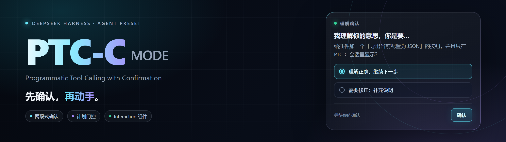
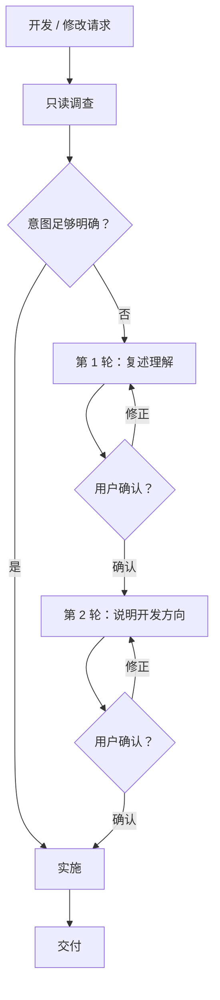
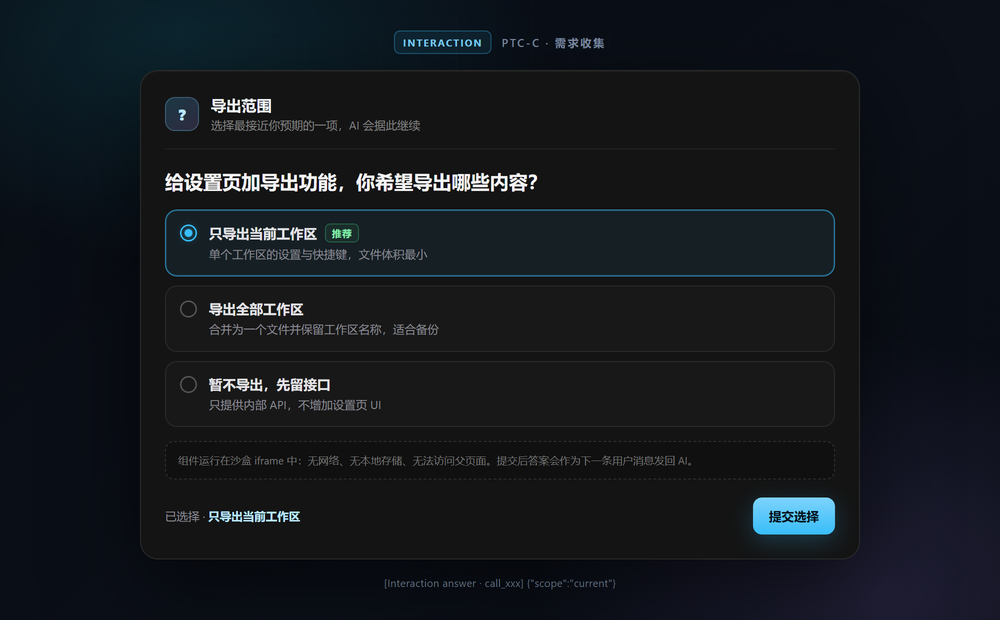

<p align="center">
  
</p>

<p align="center">
  <a href="LICENSE"></a>
  
  
  
</p>

<p align="center">
  <strong>先确认，再动手。</strong><br>
  PTC-C（Programmatic Tool Calling with Confirmation）是给
  <a href="https://github.com/deepseek-ai/deepseek-harness">DeepSeek Harness</a>
  用的 Agent 预设：开发前先对齐意图，用计划审批守住方向，
  再用可交互组件把需求问清楚。
</p>

> [!NOTE]
> 非官方社区项目，与 DeepSeek 官方无关。目前主要在 Windows 版 DSH Desktop 上验证；macOS / Linux 使用同一套 Web 客户端与 Node 端代码，理论兼容，欢迎反馈。

---

## 为什么是 PTC-C？

LLM 改代码很快，但“方向理解错”的返工很贵。PTC-C 把确认放在写代码之前：

| | 默认模式 | PTC-C |
| :-- | :-- | :-- |
| 开发前 | 直接开始改 | 先只读调查，再复述理解 |
| 方向 | 改完才发现偏了 | 两轮对话内纠正 |
| 大改 | 边做边想 | 计划文档 + UI 审批 |
| 需求收集 | 长段文字来回问 | 交互组件点选 |

它不追求更快，而是把返工成本提前消掉。意图足够明确时，它会直接做。

## 三种确认方式

| 方式 | 触发 | 你要做什么 |
| :-- | :-- | :-- |
| 软门控 · 两轮确认 | 默认，开发 / 修改类请求 | 回一句“对”或直接纠偏 |
| 硬门控 · 计划模式 | 打开输入框左侧的计划开关 | 在计划卡片上 Approve |
| Interaction 组件 | 需求有多个方向、方案或取舍 | 点选卡片并提交 |

### 软门控：两轮，只问一步

1. 第 1 轮：agent 用自己的话复述“你是要……”，然后停下。
2. 第 2 轮：你确认理解后，agent 说明“我打算改什么、大方向是……”，再次停下。
3. 两步都确认后，才开始改代码。

两步必须分两轮，不会在同一轮里连问。以下情况会跳过：

- 你明确说“直接做 / 不用确认”；
- 意图非常明确；
- 纯问答、解释、阅读类请求（不产生修改）。

### 硬门控：计划模式

打开输入框左侧的计划开关后，agent 会把「需求理解 + 开发方案」写成一份计划，通过 `exit_plan_mode` 提交 UI 审批；只有审批通过才开始实施。计划被拒绝时，它会合并你的反馈后重新提交。

### Interaction：把选择题做成组件

当需求不是一句话能说清时，agent 可以调用 `Interaction`，在聊天里渲染一个由它编写的交互组件：单选、复选、按钮、排序、参数权衡都可以。你点选提交后，答案会作为下一条用户消息回到 agent。

## 工作流程



> 计划模式开启时，上面的两轮对话由一份计划 + `exit_plan_mode` 审批替代。

## 安装

### 前置条件

- 已安装 DeepSeek Harness（桌面端或 `dsh web`）；
- 有可编辑的 DSH profile，通常位于：
  - Windows：`%USERPROFILE%\.dsh\profiles\desktop`
  - macOS / Linux：`~/.dsh/profiles/desktop`
- 已安装 pnpm。

### 方式 A：本地 link（推荐，便于改代码）

1. 克隆仓库到本地：

   ```bash
   git clone https://github.com/wkea/dsh-ptcc-mode.git
   cd dsh-ptcc-mode
   ```

2. 编辑对应 profile 的 `package.json`，在 `dependencies` 中加入：

   ```json
   "@local/dsh-ptcc-mode": "link:C:/path/to/dsh-ptcc-mode"
   ```

   在 `dsh.profile.bundles` 末尾加入：

   ```json
   "@local/dsh-ptcc-mode"
   ```

   只追加，不要覆盖原有的 bundles。

3. 在 profile 目录安装并重启 DSH：

   ```powershell
   cd $HOME\.dsh\profiles\desktop
   pnpm install
   ```

   macOS / Linux 使用 `cd ~/.dsh/profiles/desktop`。

4. 新建会话，在预设选择器中选择 **PTC-C**。

### 方式 B：直接从 GitHub 安装

把依赖改为：

```json
"@local/dsh-ptcc-mode": "github:wkea/dsh-ptcc-mode"
```

其余步骤相同。想跟随更新时，重新执行 `pnpm install` 即可。

> [!TIP]
> 插件是 DSH bundle，不需要单独构建。改完 `cordis.patch.yml` 后需要重启 DSH；preset 在启动时注册。

## 使用

### 一个例子

```text
你：给设置页加一个“导出当前配置为 JSON”的按钮，范围你定。

Agent：我理解你的意思，你是要……

你：对，就按这个理解。

Agent：我打算修改 settings 页和导出工具，大方向是……

你：可以，开始吧。

Agent：开始实施。
```

### Interaction 组件

<p align="center">
  
</p>

<p align="center">
  <sub>示意图：实际组件由 AI 用 Tailwind 生成，外观会随主题与需求变化。</sub>
</p>

组件在沙盒 iframe 中运行，AI 代码可以操作：

```js
// #app 是唯一挂载点
const app = document.getElementById("app");
app.innerHTML = `<div class="p-4">...</div>`;

// 提交最终答案（JSON 可序列化）
window.dsh.answer({ scope: "current" });

// 向组件下方的日志区追加一行
window.dsh.log("已选择：当前工作区");
```

`console.log / warn / error` 也会转发到日志区。页面内置 Tailwind CSS v3 运行时，直接写工具类即可；颜色、间距、圆角、过渡都由 AI 现场生成。

## 配置

| 想调整 | 位置 |
| :-- | :-- |
| persona / 确认规则 | `cordis.patch.yml` → `preset-ptc-c` → `persona.prefix` |
| 计划模式提示 | `cordis.patch.yml` → `planning` → `plan-mode.config.section` |
| Interaction 代码上限 | `lib/tools.js` → `MAX_CODE_BYTES`（默认 64 KB） |
| 答案 / 日志 / 初始高度 | `lib/client.js` → `MAX_RESULT_CHARS` / `MAX_LOGS` / `DEFAULT_HEIGHT` |
| 交互样式 | `lib/client.js` 中的沙盒样式与 Tailwind 运行时 |

> [!WARNING]
> persona 是**严格模板**。当前 DSH 只注册 `{{provider}}` 和 `{{model}}` 两个变量；工作目录由运行时上下文提供。不要写 `{{cwd}}` 或其他未注册变量，否则整轮请求会直接失败（`unknown prompt variable`）。

## 项目结构

```text
dsh-ptcc-mode/
├── cordis.patch.yml        # DSH bundle patch：插入 preset-ptc-c
├── lib/
│   ├── index.js            # 宿主根入口：只承载客户端 bundle 名册
│   ├── tools.js            # Interaction 工具（Node 端）
│   ├── client.js           # 浏览器端 toolview：沙盒 iframe
│   └── vendor/
│       └── tailwind.min.js # 离线 Tailwind 运行时
├── package.json            # dsh.bundle / dsh.client 声明
├── LICENSE
├── THIRD_PARTY_NOTICES.md
└── README.md
```

## 工作原理

1. DSH 读取 `package.json` 的 `dsh.bundle.patch`，把 `cordis.patch.yml` 合入 profile。
2. patch 插入 `preset-ptc-c`：persona、计划门控、工具列表都在这里声明。
3. `Interaction` 只挂在这个预设的插件列表里，因此只有 PTC-C 会话能看到它。
4. `dsh.client` 指向 `lib/client.js`，它注册 `tool.call.toolview` 插槽；工具调用到达时创建沙盒 iframe。
5. 用户提交答案后，客户端把答案整理成可读文本（标题行「Interaction 已提交 · 组件标题」，下面按 `- 键：值` 逐行列出），通过 `ctx.remote.session.prompt` 作为下一条用户消息发回。

## 安全

Interaction 运行的是 AI 生成的代码，按不可信内容处理：

- iframe 使用 `sandbox="allow-scripts"`，没有 `allow-same-origin`，源不透明，无法读取父页面、Cookie 或本地存储；
- CSP 为 `default-src 'none'`、`connect-src 'none'`，没有网络请求；
- 父子通信只接受来自当前 iframe 的 `answer / log / resize` 消息；
- 代码上限 64 KB，答案上限 32K 字符，日志最多 200 行，高度 80–1200 px；
- 组件只拿到 `#app` 挂载点与 `window.dsh` 两个 API。

沙盒是纵深防御，不是对宿主本身的绝对安全保证。不要在组件里输入密钥、密码或其他敏感信息。

## 开发

```bash
git clone https://github.com/wkea/dsh-ptcc-mode.git
# 按“方式 A”把仓库 link 进 profile
```

- **无构建步骤**：DSH 直接加载 `lib/*.js` 与 `cordis.patch.yml`。
- 改 `cordis.patch.yml` 后重启 DSH；preset 在启动时注册。
- 改客户端组件后刷新页面或重启 DSH。
- 修改 `package.json` 后，在 profile 目录执行一次 `pnpm install`。
- JS 使用 tab 缩进，YAML 使用 2 空格。
- 提交前至少验证一遍 YAML；如果改 persona，确认没有引入未注册的模板变量。

## FAQ

<details>
<summary><strong>安装后看不到 PTC-C？</strong></summary>

- 确认 `@local/dsh-ptcc-mode` 同时出现在 profile 的 `dependencies` 和 `dsh.profile.bundles` 中；
- 在 profile 目录执行 `pnpm install`；
- 完全重启 DSH，而不是只刷新页面；
- 新建会话时在预设选择器里查找 **PTC-C**。

</details>

<details>
<summary><strong>Interaction 组件不显示或是一片空白？</strong></summary>

- 确认 `@local/dsh-ptcc-mode` 在 bundles 中，并且 profile 已安装；
- 组件只在 PTC-C 会话中注册；其他预设看不到这个工具；
- 空白通常是 AI 生成的 JS 报错，展开调用下方的日志区查看；
- 首次加载时 Tailwind 运行时需要一点时间，稍等即可。

</details>

<details>
<summary><strong>报错 <code>unknown prompt variable "{{cwd}}"</code>？</strong></summary>

这是旧版 persona 模板与当前 DSH 变量集合不匹配导致的。当前 DSH 只注册 `provider` 和 `model`；把 persona 里的 `{{cwd}}` 删掉即可。工作目录已经由运行时上下文提供。本仓库已修复。

</details>

<details>
<summary><strong>能在 <code>dsh web</code> 里用吗？</strong></summary>

可以。把 bundle 加到 `~/.dsh/profiles/web/package.json` 的 `dependencies` 与 `dsh.profile.bundles`，执行 `pnpm install` 后重启 `dsh web`。

</details>

<details>
<summary><strong>会不会多花很多 token？</strong></summary>

确认通常只是几轮很短的往返；计划模式多一份计划；Interaction 的代码受 64 KB 上限约束，且只有需要时才触发。相比改错方向后的返工，成本通常更低。

</details>

## 许可证

MIT © 2026 [wkea](https://github.com/wkea)

内置的 Tailwind CSS 运行时（v3.4.16）来自 Tailwind Labs，按 MIT 许可分发；完整声明见 [THIRD_PARTY_NOTICES.md](THIRD_PARTY_NOTICES.md)。

---

<p align="center">
  <sub>Built for <a href="https://github.com/deepseek-ai/deepseek-harness">DeepSeek Harness</a> · 非官方项目</sub><br>
  <sub>如果它帮你少返工一次，欢迎点个 ⭐</sub>
</p>
